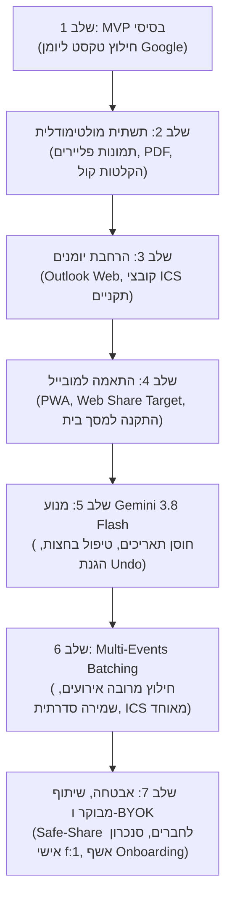
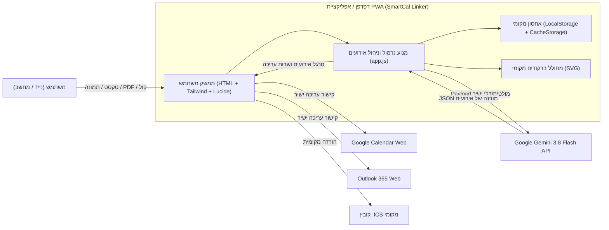

# תיעוד מערכת מלא — SmartCal Linker ("יומן חכם")
**גרסת מערכת:** `v20261027_02` | **תאריך עדכון:** אוקטובר 2026  
**סביבת ייצור (Production):** [https://dymvie-alt.github.io/smartcal-linker/](https://dymvie-alt.github.io/smartcal-linker/)  
**מאגר קוד (GitHub):** [https://github.com/dymvie-alt/smartcal-linker](https://github.com/dymvie-alt/smartcal-linker)

---

## תוכן עניינים
1. [תמצית מנהלים (Executive Summary)](#1-תמצית-מנהלים-executive-summary)
2. [מה הייתה המטרה ולמה המערכת נותנת מענה (The Problem & Solution)](#2-מה-הייתה-המטרה-ולמה-המערכת-נותנת-מענה-the-problem--solution)
3. [תהליך הפיתוח והאבולוציה ההנדסית (Engineering Evolution & Milestones)](#3-תהליך-הפיתוח-והאבולוציה-ההנדסית-engineering-evolution--milestones)
4. [ארכיטקטורת המערכת והטכנולוגיות (System Architecture & Tech Stack)](#4-ארכיטקטורת-המערכת-והטכנולוגיות-system-architecture--tech-stack)
5. [יכולות המוצר וכל האפשרויות (Product Capabilities & Deep Dive)](#5-יכולות-המוצר-וכל-האפשרויות-product-capabilities--deep-dive)
6. [מודל אבטחה, פרטיות ו-Governance (Security & BYOK)](#6-מודל-אבטחה-פרטיות-ו-governance-security--byok)
7. [סיכום ומבט לעתיד (Summary & Roadmap)](#7-סיכום-ומבט-לעתיד-summary--roadmap)

---

## 1. תמצית מנהלים (Executive Summary)

**SmartCal Linker ("יומן חכם")** היא אפליקציית ווב ומובייל מתקדמת (Progressive Web App - PWA), מבוססת בינה מלאכותית מולטימודלית מהדור החדש (**Google Gemini 3.8 Flash**), שנועדה לחסל לחלוטין את החיכוך, הבזבוז והטעויות הכרוכים בהזנה ידנית של אירועים ליומנים דיגיטליים.

המערכת מאפשרת לכל משתמש להזין מידע מכל מקור אפשרי — **הודעת וואטסאפ חופשית, קישור לדף אירוע/וובינר, צילום פלייר או הזמנה מודפסת, כרטיס טיסה ב-PDF, או הקלטה קולית טבעית** — ולתרגם אותו בתוך שניות בודדות לאירוע מדויק, מועשר ומובנה ביומן Google, ביומן Outlook Web או בקובץ יומן סטנדרטי (`.ics`).

### הישגים מרכזיים של המערכת:
* **Zero-Backend Architecture (100% Client-Side):** המערכת פועלת כולה מתוך דפדפן המשתמש ללא שרת מרכזי האוגר מידע, ללא בסיס נתונים בענן, וללא עלויות אחזקת שרתים.
* **חילוץ מולטי-אירועים מובנה (Multi-Event Batching):** זיהוי ופיצול אוטומטי של מספר אירועים מקלט בודד (למשל: כרטיס טיסות הלוך-חזור, לו"ז כנס, או סדרת מפגשים) עם סרגל ניווט אינטואיטיבי, שמירה סדרתית מהירה בלחיצה אחת, והורדת קובץ `.ics` מאוחד.
* **תמיכה באירועים חוזרים (`RRULE`):** זיהוי אוטומטי מתוך שפה חופשית של מופעים שבועיים, דו-שבועיים, חודשיים ושנתיים והזרקתם לפרוטוקול היומן.
* **ניהול יומנים מרובה מוזמנים (מערך "2יומן"):** ניתוב אירועים בלחיצה אחת בין יומנים אישיים, משפחתיים או עסקיים עם הוספה אוטומטית של רשימות תפוצה ומשתתפים קבועים.
* **שיתוף בטוח מבוסס BYOK (Bring Your Own Key):** המשתמש שולט במפתח ה-API האישי והחינמי שלו מ-Google. הפרדה מוחלטת בין **שיתוף נקי לחברים** (ללא חשיפת מפתח או מיילים) לבין **סנכרון אישי מהיר** למכשירי המשפחה.

---

## 2. מה הייתה המטרה ולמה המערכת נותנת מענה (The Problem & Solution)

### נקודות הכאב בעולם האמיתי (Pain Points)
בחיי היומיום והעבודה, אירועים מגיעים אלינו בעשרות ערוצים מבוזרים ולא מובנים:
1. **הודעות טקסט וואטסאפ:** הודעות קבוצתיות ארוכות שבהן מועד המפגש והמיקום קבורים עמוק בתוך פסקאות מלל.
2. **הזמנות גרפיות (תמונות):** פליירים של הופעות, הזמנות לחתונה/בר מצווה, או צילומי מסך שלא ניתן להעתיק מהם טקסט ישירות.
3. **כרטיסי טיסה והזמנות מלון (PDF):** קבצים מורכבים מרובי מקטעים (טיסת הלוך, טיסת המשך, נחיתה ביעד, שעות שונות באזורי זמן משתנים).
4. **שיחות והודעות קוליות:** רעיונות, סיכומים טלפוניים או תזכורות שצריך להקליד מחדש ידנית אות אחר אות.
5. **דפי נחיתה ואירועי רשת (URLs):** קישורים לוובינרים, מכירות כרטיסים או דפי רישום הדורשים חיפוש מתיש של תאריך ושעת תחילת האירוע.

### כשל ההזנה הידנית
הניסיון לפתוח את אפליקציית היומן, להעתיק שורה שורה, להגדיר תאריך התחלה, שעת סיום, להקליד כתובת בוויז, ולהוסיף את בן/בת הזוג למוזמנים — אורך בממוצע **2 עד 4 דקות לאירוע**. כתוצאה מכך, אירועים רבים נשכחים, מוזנים בשעות שגויות, או שאינם משותפים עם בני המשפחה.

### המענה של SmartCal Linker
SmartCal Linker מהווה **שכבת תרגום אוטומטית (Zero-Friction Ingestion)** בין העולם הבלתי-מובנה לבין היומן הדיגיטלי:
* זורקים לאפליקציה כל דבר (טקסט, תמונה, מסמך או קול).
* המערכת מפענחת את ההקשר (Context), מתקנת יחסית לתאריך הנוכחי ("יום שלישי הבא", "מחרתיים בערב"), מחלצת שעות, מיקום ומוזמנים.
* בלחיצה אחת — האירוע מוכן ופתוח ביומן הנכון עם כל השדות מלאים.

---

## 3. תהליך הפיתוח והאבולוציה ההנדסית (Engineering Evolution & Milestones)

המערכת פותחה בתהליך אג'ילי מואץ, מבוסס משוב משתמשים אמיתי (User Feedback Loops), תוך מעבר מתמיד מרעיון בסיסי (PoC) למוצר שלם ומאובטח:

### אבני הדרך העיקריות:
1. **שלב 1 — MVP מבוסס טקסט:** הוכחת היתכנות של פנייה ישירה מ-JavaScript ל-Gemini API עם הנחיה (Prompt) שמחזירה JSON מובנה ויצירת קישור עריכה ל-Google Calendar (`render.google.com/calendar/render?action=TEMPLATE...`).
2. **שלב 2 — תמיכה מולטימודלית רחבה:** שילוב יכולות הראייה הממוחשבת (Vision) של Gemini לפענוח פליירים, הדבקת תמונות ישירה מהלוח (`Ctrl+V`), המרת מסמכי PDF של כרטיסי טיסה ל-Base64, ושימוש ב-Web MediaRecorder API להקלטה קולית מקומית בדפדפן.
3. **שלב 3 — יומנים מרובים ומערך "2יומן":** הוספת סרגל כפתורים מהיר לניתוב בין חשבונות שונים, תמיכה בהוספה אוטומטית של רשימות מוזמנים (למשל: סנכרון אוטומטי של אירועי משפחה עם בן/בת הזוג), תמיכה ב-Outlook Web והפקת קובצי `.ics` תואמי RFC-5545 עבור Apple Calendar.
4. **שלב 4 — מובייל PWA ו-Web Share API:** התאמה מלאה למסכי מגע, יצירת `manifest.json` ו-`sw.js` להתקנה כאפליקציה על מסך הבית בנייד (PWA), וחיבור ל-Web Share Target המאפשר לשתף טקסט ישירות מוואטסאפ לתוך האפליקציה.
5. **שלב 5 — שדרוג מנוע, חוסן תאריכים והגנת נתונים:** מעבר למודל העדכני של גוגל (`gemini-3.8-flash`), פיתוח אלגוריתם עצמאי לטיפול באירועים החוצים את חצות הלילה (שעת סיום נמוכה משעת התחלה), שמירת תאריך נוכחי מדויק למניעת הזזות תאריכים, והטמעת מנגנון "הגנת איפוס" שמתריע ומאפשר שחזור (Undo) אם אירוע טרם נשמר ביומן.
6. **שלב 6 — מנוע Multi-Events Batching (מהפכת ריבוי האירועים):** שדרוג הסכמה מול Gemini לפורמט מרובה אירועים (`events: [...]`). הוספת סרגל ניווט ויזואלי, מחיקת אירועים לא רצויים, שמירה סדרתית המעבירה אוטומטית לאירוע הבא, והורדת קובץ ICS מאוחד.
7. **שלב 7 — הפרדת שיתוף, הגנת פרטיות ו-Onboarding:** פיתוח מודל שיתוף דו-ערוצי:
   * **שיתוף נקי לחברים:** קישור וקוד QR ללא מפתח API וללא יומנים, עם אשף כניסה של 30 שניות (Onboarding Wizard) ומדריך מובנה.
   * **סנכרון אישי למכשיר שלי:** קישור וקוד QR מוצפנים קומפקטיים (עם דגל `f:1`) להעברה מאובטחת של כל הגדרות ה-API ויומני `2יומן` לטלפון האישי.

---

## 4. ארכיטקטורת המערכת והטכנולוגיות (System Architecture & Tech Stack)

המערכת בנויה על פי עקרונות **Local-First & Zero-Backend** המבטיחים מהירות מקסימלית, פרטיות מלאה ואמינות ללא תלות בשרת ייעודי.

### עץ הטכנולוגיות (Tech Stack)
* **צד לקוח (Frontend Core):** Vanilla HTML5, Modern ECMAScript (ES2024), Tailwind CSS (באמצעות CDN קל משקל), וספריית האייקונים Lucide.
* **בינה מלאכותית (AI Engine):** Google Gemini 3.8 Flash (`gemini-3.8-flash`) הפועל בפרוטוקול REST מובנה מול ה-Endpoint הרשמי `generativelanguage.googleapis.com/v1beta/models/...:generateContent` עם `response_schema` מוגדר (JSON קשיח).
* **אחסון וסנכרון מקומי (Client-Side Storage):**
  * `localStorage`: שמירת הגדרות תצורה, מפתח API, היסטוריית 20 אירועים אחרונים, ומודל ברירת מחדל.
  * `CacheStorage`: שמירת גיבוי הגדרות (`smartcal-config-backup-v1`) לשיתוף חלק של התצורה בין דפדפן המובייל לאפליקציית מסך הבית המותקנת (Standalone PWA).
* **שירותי רשת ומובייל (PWA & Service Worker):**
  * `sw.js`: ארכיטקטורת **Network-First** המבטיחה שתמיד נטענת הגרסה העדכנית ביותר של הקוד מהשרת, עם גיבוי במקרה של ניתוק רשת, ומניעת תקיעת Cache ישן.
  * `manifest.json`: הגדרת אפליקציית PWA, אייקונים מותאמים, וקולט שיתוף מובנה (`share_target`).
* **קוד QR מקומי:** מחולל QR עצמאי מבוסס וקטורי SVG הפועל בזיכרון המקומי ללא שליחת נתונים לשירותי צד-שלישי.

---

## 5. יכולות המוצר וכל האפשרויות (Product Capabilities & Deep Dive)

### א. ערוצי קליטה מולטימודליים (Input Modalities)
1. **טקסט חופשי והודעות וואטסאפ:** הדבקה ישירה של הודעות. המערכת יודעת להתעלם מברכות וטקסט לא רלוונטי ולהתמקד בלוח הזמנים.
2. **קישור אינטרנט חי (URL Fetching):** המערכת מזהה קישורי אינטרנט (למשל לדפי מכירת כרטיסים או וובינרים), שולפת את תוכן הדף ומחלצת את הפרטים.
3. **תמונות ופליירים (Computer Vision):** העלאת קבצים או הדבקה ישירה מהלוח באמצעות **`Ctrl + V`**. המנוע מפענח טקסט, תאריכים ושעות מתוך גרפיקה, הזמנות אירועים ומודעות.
4. **מסמכי PDF:** העלאת כרטיסי טיסה (e-Tickets), תוכניות כנס או אישורי מלון. המערכת קוראת את המסמך השלם ומחלצת את כל מקטעי הלו"ז.
5. **הקלטה קולית טבעית (Voice-to-Calendar):** הקלטה ישירה מהמיקרופון עם מד זמן חזותי. המערכת מקודדת את האודיו ושולחת אותו לפענוח ישיר של Gemini.
6. **קיצור דרך גלובלי:** לחיצה על `Ctrl + Enter` בתיבת הטקסט מפעילה מיד את החילוץ.

### ב. מנוע Multi-Events Batching (ריבוי אירועים)
* **זיהוי אוטומטי:** קלט המכיל יותר מאירוע אחד (למשל: טיסת הלוך ב-10/11 וטיסת חזור ב-17/11) מפענח את כל האירועים לרשימה סדורה.
* **סרגל ניווט עליון:** מציג את כמות האירועים שזוהו (`אירוע 1 מתוך 2`) ומאפשר דפדוף מהיר ביניהם.
* **עריכה ומחיקה:** אפשרות לערוך כל אירוע בנפרד או למחוק אירועים שאינם רלוונטיים (`×`).
* **שמירה סדרתית חכמה (Auto-Advance):** לחיצה על "פתח ושמור ביומן Google" פותחת את האירוע, מסמנת אותו כנשמר (`✓`), ומעבירה את התצוגה אוטומטית לאירוע הבא שטרם נשמר!
* **הורדת ICS מאוחד:** כפתור ייעודי להורדת קובץ יומן בודד המכיל בתוכו את כל האירועים יחד לייבוא מרוכז בלחיצה אחת.

### ג. אירועים חוזרים (Recurring Events - RRULE)
* **זיהוי שפה חופשית:** מזהה ניסוחים כגון "בכל יום שלישי", "פעם בחודש", "כל שבועיים בימי חמישי".
* **תאימות ליומנים:** בונה חוק חזרתיות תקני (`RRULE:FREQ=WEEKLY;BYDAY=TU`), מציג תגית ויזואלית סגולה בולטת בטופס, ומזריק את ההגדרה ישירות ליומן Google.

### ד. ניהול סרגל החשבונות (סביבת "2יומן")
* **סרגל כפתורים עליון:** החלפה מהירה בין יומנים אישיים, עסקיים ומשפחתיים.
* **תוויות זיהוי:** הצגת קיצור כתובת המייל (`user@`) כדי לוודא לאיזה חשבון האירוע ישויך.
* **הזמנה אוטומטית של משתתפים:** שיוך רשימות תפוצה קבועות לכל חשבון (לדוגמה: בחירה ביומן "משפחה" מוסיפה אוטומטית את בני המשפחה למוזמני האירוע).
* **התאמה אישית מלאה:** מסך הגדרות (⚙️) המאפשר הוספה, עריכה ומחיקה של יומנים וכתובות מוזמנים.

### ה. ייצוא והפצה (Calendar Integrations)
1. **Google Calendar Web:** פתיחת חלון עריכה ישיר עם כותרת, זמנים, מיקום, תיאור מלא, רשימת מוזמנים, וקישור ישיר למקור.
2. **Outlook 365 / Web:** יצירת אירוע מובנה בחשבונות Microsoft / Outlook.
3. **קובצי `.ics` תקניים:** יצירת קובץ התואם במדויק את תקן RFC-5545, כולל קידוד תווים בעברית (`UTF-8`), שורות `ATTENDEE` מוזמנים תקינות, ופתרון אזורי זמן.
4. **שיתוף WhatsApp ישיר:** כפתור לשליחת תמצית האירוע המוכנה והמעוצבת ישירות בהודעת וואטסאפ למשתתפים.

### ו. מנגנון מחיקה חכם והגנת Undo
* אם המשתמש לוחץ על "נקה טופס" כאשר האירועים חולצו אך טרם נשמרו ביומן — מוקפץ חלון אישור ברור המונע אובדן מידע בטעות.
* לאחר אישור המחיקה, מופיעה התראה צפה (Toast) עם כפתור **"בטל (Undo)"** המאפשר לשחזר מיד את כל המידע שנוקה.

### ז. היסטוריית אירועים מקומית
* האפליקציה שומרת אוטומטית את 20 האירועים האחרונים שחולצו בזיכרון המקומי.
* חלון "היסטוריה" מאפשר לחפש אירועי עבר, לצפות בפרטיהם, או לפתוח אותם מחדש ביומן בכל שלב.

---

## 6. מודל אבטחה, פרטיות ו-Governance (Security & BYOK)

המערכת פותחה תוך הקפדה על עקרונות **Privacy by Design** ו-**Secure-by-Default**:

### 1. מודל Bring Your Own Key (BYOK)
* במקום להחזיק מפתח מערכתי מרכזי החשוף לניצול לרעה או לדרוש תשלום חודשי על שרתים, כל משתמש מחזיק במפתח Gemini API אישי וחינמי משלו מבית Google AI Studio.
* מפתח ה-API נשמר אך ורק ב-`localStorage` של הדפדפן הספציפי במכשיר של המשתמש. הוא אינו מועבר לאף שרת חיצוני למעט שרתי ה-API הרשמיים של גוגל.

### 2. הפרדה בין "שיתוף לחבר" לבין "סנכרון אישי"
כדי למנוע דליפה מקרית של מפתח ה-API או של כתובות המייל המשפחתיות, מנגנון השיתוף (כפתור "שתף / QR לנייד") מפוצל לשני מסלולים נפרדים הרמטית:
* **מסלול א': שתף לחבר (ברירת מחדל ירוקה ובטוחה):**
  * הקישור וקוד ה-QR נקיים לחלוטין מכל מזהה אישי (`https://dymvie-alt.github.io/smartcal-linker/`).
  * משתמש חדש שיסרוק או ייכנס דרך קישור זה יקבל אפליקציה נקייה עם יומן ברירת מחדל אישי, ואשף קבלת פנים (Onboarding Wizard) של 30 שניות שינחה אותו כיצד להוציא מפתח אישי משלו בחינם מגוגל.
* **מסלול ב': סנכרון למכשיר שלי / משפחה (לשונית מוגנת):**
  * מאפשר לבעל המערכת לסנכרן את המחשב עם הנייד האישי שלו או עם מכשירי המשפחה.
  * הנתונים מועברים ב-URL Hash מקומי (`#setup=...`) שמוצפן ב-Base64.
  * **אופטימיזציית QR חכמה (`f:1`):** כאשר מועברים יומני `2יומן`, המערכת שולחת דגל קומפקטי קצרצר במקום לקודד את כל המיילים והשמות, מה שמייצר ברקוד חד, קטן ומהיר ביותר לסריקה.
  * **השמדה עצמית משורת הכתובת:** מיד עם טעינת הדף וקליטת ההגדרות, ה-Hash נמחק מידית משורת הכתובת ומהיסטוריית הדפדפן (`history.replaceState`), כך שהמפתח אינו נשאר גלוי בהיסטוריה.

---

## 7. סיכום ומבט לעתיד (Summary & Roadmap)

### סיכום
**SmartCal Linker** הוכיחה כיצד שילוב של ארכיטקטורת Zero-Backend יחד עם יכולות מולטימודליות מהדור החדש (`Gemini 3.8 Flash`) מאפשר לייצר מוצר ברמת איכות וגימור גבוהה במיוחד, במהירות תגובה של שניות בודדות, באפס עלויות תשתית, ועם שמירה בלתי מתפשרת על פרטיות המשתמשים.

### 5 כיווני התפתחות מוצעים לגרסאות הבאות (Roadmap)
1. **זיהוי קונפליקטים מול יומן Google הקיים:** בדיקת עומסים וקונפליקטים מול לוח הזמנים הקיים של המשתמש בטרם פתיחת האירוע.
2. **תמיכה מורחבת ברישיונות ארגוניים (Google Workspace / Microsoft Graph API):** הוספת אפשרות לסנכרון רקע ישיר ללא צורך בלחיצה על כפתור פתיחת הטאב של היומן.
3. **תזכורות מותאמות אישית חכמות:** חילוץ אוטומטי של זמני הגעה מומלצים (למשל: תזכורת 3 שעות לפני לטיסה בינלאומית מול תזכורת 30 דקות לפגישת זום).
4. **הרחבת תמיכה באזורי זמן משתנים (Multi-Timezone Flights):** חישוב הפרשי שעות אוטומטי בהמראות ונחיתות בין מדינות שונות.
5. **ווידג'ט חי / קיצור דרך במערכת ההפעלה (iOS Shortcuts & Android Quick Settings):** הפעלת צילום או הקלטה ישירה מלוח הווידג'טים במסך הנעילה.

---
*מסמך זה נכתב ונבדק כחלק מתיעוד הגרסה הרשמית `v20261027_02`.*
